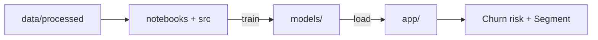

<div align="center">

# 🛒 CIRP
### Customer Intelligence & Retention Platform

Predict which customers are about to leave, and understand who your customers really are.


</div>

---

## 📑 Table of Contents

- [Overview](#-overview)
- [Features](#-features)
- [Project Structure](#-project-structure)
- [How It Works](#-how-it-works)
- [Getting Started](#-getting-started)
- [Usage](#-usage)
- [Data](#-data)
- [Contributing](#-contributing)

---

## 📖 Overview

CIRP is a machine learning platform that helps online retailers understand their customers and keep them from leaving. It is built on the Online Retail II dataset, which contains real transactions from a UK-based online store.

The Problem

Winning a new customer costs far more than keeping an existing one, yet most businesses only notice a customer is gone after it is too late. On top of that, treating all customers the same wastes marketing effort: a loyal big spender and a one-time buyer need very different attention.

Our Solution

CIRP answers two questions for every customer:

Who is about to leave? A churn model looks at each customer's purchase history (recency, frequency, spending and more) and predicts the probability that they will not place an order in the next 90 days.
Who are they? A clustering model groups customers into 6 behavioral segments. Each segment has a clear name, a short description and a suggested action, so the business knows what to do next (for example, reward, re-engage or nurture).

Both models are exposed through simple Python functions and a Streamlit app, so a business user can enter a customer and instantly see their churn risk, their segment and the recommended action..

## ✨ Features

| Component | What it does |
|---|---|
| 🔮 **Churn Prediction** | Predicts which customers are likely to stop buying (no order in the next 90 days). |
| 👥 **Customer Segmentation** | Groups customers into 5 behavioral segments, each with a name, a description and a suggested action. |
| 🖥️ **Streamlit App** *(in progress)* | Shows the churn risk and the segment of a customer. |

## 🗂️ Project Structure

```text
data/
├── raw/                 # raw transactions (not pushed to git)
├── processed/           # clean dataset + train / val / test / full_train (+ *_scaled)
├── segmentation/        # one row per customer + clusters and profiles
├── samples/             # sample_customers.csv (20 customers for quick tests)
└── data_dictionary.csv
notebooks/
├── 01_data_prep.ipynb       # data cleaning check, EDA, feature selection, scaling
├── 02_segmentation.ipynb    # K-Means / DBSCAN, segments, names, model saving
├── 03_prediction.ipynb      # Logistic Regression, Decision Tree, Random Forest, threshold
└── archive/                 # old experiments
src/
├── prediction/          # train.py, evaluate.py, churn_predictor.py (used by the app)
└── segmentation/        # segment_predictor.py (used by the app)
models/
├── prediction/churn_model.joblib
├── segmentation/segmentation_model.joblib
└── preprocessor_robust.joblib
reports/                 # EDA_Report.docx and figures/
app/                     # Streamlit application (to be added)
docs/                    # hand-off notes, data instructions and project documents
tests/                   # automated tests (to be added)
```

## 🔗 How It Works



## 🚀 Getting Started

**1. Create a virtual environment**

```bash
python -m venv .venv
source .venv/bin/activate        # Windows: .venv\Scripts\activate
```

**2. Install dependencies**

```bash
pip install -r requirements.txt
```

> [!NOTE]
> `scikit-learn` is pinned to **1.9.0** because the saved preprocessor was created with it.

## 🧪 Usage

Run these commands from the project root:

```bash
python src/prediction/train.py                      # train the churn model and save it
python src/prediction/evaluate.py                   # results on the test set
python src/prediction/test_predictor.py             # predict one customer
python src/segmentation/test_segment_predictor.py   # segment of one customer
```

### Use the models in your app

```python
from src.prediction.churn_predictor import predict_churn
from src.segmentation.segment_predictor import predict_segment

predict_churn(customer_dict)      # all 22 features -> probability + 0/1
predict_segment(customer_dict)    # the 9 segmentation features -> segment name, description, action
```

## 📊 Data

- Each row is a customer at a quarterly snapshot (**5 snapshots, 22 features**). `churn = 1` means no order in the 90 days after the snapshot.
- Time-based split: `train` (3 snapshots), `val`, `test`. `full_train` = train + val, used for the final model.


More details: [`docs/MODELER_HANDOFF.md`](docs/MODELER_HANDOFF.md) · [`data/data_dictionary.csv`](data/data_dictionary.csv) · [`reports/EDA_Report.docx`](reports/EDA_Report.docx)

## 🤝 Contributing

1. Create one branch per person (for example `feature-segmentation`).
2. Open a Pull Request into `main`.
3. Do not push `data/raw/` or large files.
