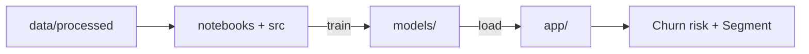

<div align="center">

# CIRP
### Customer Intelligence & Retention Platform

Predict which customers are about to leave, and understand who your customers really are.


</div>

---

## Overview

CIRP is a machine-learning project for an online retailer. It uses the public **Online Retail II**
dataset (real transactions from a UK-based store) and answers two questions for every customer:

1. **Who is about to leave?** A Random Forest predicts the probability that the customer will not
   place an order in the next 90 days.
2. **Who are they?** A K-Means model groups customers into **5 behavioural segments**. Each segment
   has a name, a short description and a suggested action, so the business knows what to do next.

Both models are exposed through a Streamlit dashboard, so a business user can open a customer,
see the churn risk, the segment and the recommended action, or score a whole CSV file at once.

## Features

| Component | What it does |
|---|---|
| **Churn Prediction** | Predicts which customers are likely to stop buying (no order in the next 90 days). |
| **Customer Segmentation** | Groups customers into 5 behavioural segments, each with a name, a description and a suggested action. |
| **Streamlit App** | Five pages: overview & EDA, segments, single-customer simulator, batch scoring and model performance. |
| **Batch Scoring** | Upload a CSV, score every row, and download the results. |
| **Model Comparison** | A separate Deep Learning experiment tests whether a neural network can beat the Random Forest. |

## Deep Learning experiment (testing only)

The `deep learning/` folder is an **isolated test**, not part of the production pipeline. Three
network families were tried on the same 22 features and the same time-based split: **MLP,
FT-Transformer and TabNet** (30 configurations, selected on validation only).

The best network reached **71.84 %** test accuracy versus **69.94 %** for the Random Forest, but it
had **lower recall** (93.14 % vs 95.87 %) and a **lower PR-AUC** (0.8082 vs 0.8224). Because missing
a churner is more expensive than a false alarm, the project kept the Random Forest. The experiment
is kept for documentation and re-runs.

See [`deep learning/README.md`](deep%20learning/README.md) and
[`deep learning/REPORT.md`](deep%20learning/REPORT.md) for details.

## Project structure

```text
app/
  app.py                   Streamlit application (5 pages, loads the saved models)
  assets/                  logo and UI images
  _legacy_5clusters/       5-segment model + profile table + diagnostic plots used by the app
data/
  raw/                     raw transactions (not pushed to git)
  processed/               clean dataset + train / val / test / full_train (+ *_scaled)
  segmentation/            one row per customer + clusters and profiles
  samples/                 sample_customers.csv (20 customers for quick tests)
  data_dictionary.csv
notebooks/
  01_data_prep.ipynb       data cleaning check, EDA, feature selection, scaling
  02_segmentation.ipynb    K-Means / DBSCAN, segments, names, model saving
  03_prediction.ipynb      Logistic Regression, Decision Tree, Random Forest, threshold
  archive/                 old experiments
src/
  prediction/              train.py, evaluate.py, churn_predictor.py
  segmentation/            segment_predictor.py
models/
  prediction/              churn_model.joblib (Random Forest + threshold + feature list)
  segmentation/            segmentation_model.joblib (segmentation package)
deep learning/             isolated DL comparison (see its README)
reports/                   EDA report and figures
tests/incoming/            notebook for scoring new customer data
```

## How it works



## Getting started

**1. Create a virtual environment**

```bash
python -m venv .venv
source .venv/bin/activate        # Windows: .venv\Scripts\activate
```

**2. Install dependencies**

```bash
pip install -r requirements.txt
```

> `scikit-learn` is pinned to **1.9.0** because the saved models were checked against that version.

**3. Run the dashboard**

```bash
streamlit run app/app.py
```

It opens on **http://localhost:8501** and loads the saved models from `models/` and
`app/_legacy_5clusters/`, and the data from `data/`.

## Usage

Run these commands from the project root:

```bash
python src/prediction/train.py                      # train the churn model and save it
python src/prediction/evaluate.py                   # results on the test set
python src/prediction/test_predictor.py             # score one customer
python src/segmentation/test_segment_predictor.py   # segment of one customer
```

### Use the models in your code

```python
from src.prediction.churn_predictor import predict_churn
from src.segmentation.segment_predictor import predict_segment

predict_churn(customer_dict)      # all 22 features -> probability + 0/1
predict_segment(customer_dict)    # the 9 segmentation features -> segment name, description, action
```

## Data

- Each row is a customer at a quarterly snapshot: **5 snapshots**, **22 features**, **22,372 rows**
  and **5,253 unique customers**.
- `churn = 1` means the customer did not place a valid order in the 90 days after the snapshot.
- Time-based split: `train` (3 snapshots), `val` (June 2011), `test` (September 2011).
  `full_train = train + val` is used for the final model.
- Raw transactions are not committed to git. To rebuild the dataset, download **Online Retail II**
  and place the Excel file in `data/raw/` (`openpyxl` is needed to read it).

More details: [`data/data_dictionary.csv`](data/data_dictionary.csv) and
[`reports/EDA_Report.docx`](reports/EDA_Report.docx).

## Notes

- The dashboard uses the 5-segment model in `app/_legacy_5clusters/`; the segmentation package in
  `models/segmentation/` is the newer 6-cluster run kept for reference.
- The two `test_*.py` scripts under `src/` are quick sanity checks, not a full automated test suite.
- The Deep Learning experiment needs extra packages (`torch`, `pytorch-tabnet`) that are not part
  of the main `requirements.txt`.

## Contributing

1. Create one branch per person (for example `feature-segmentation`).
2. Open a Pull Request into `main`.
3. Do not push `data/raw/` or large files.
